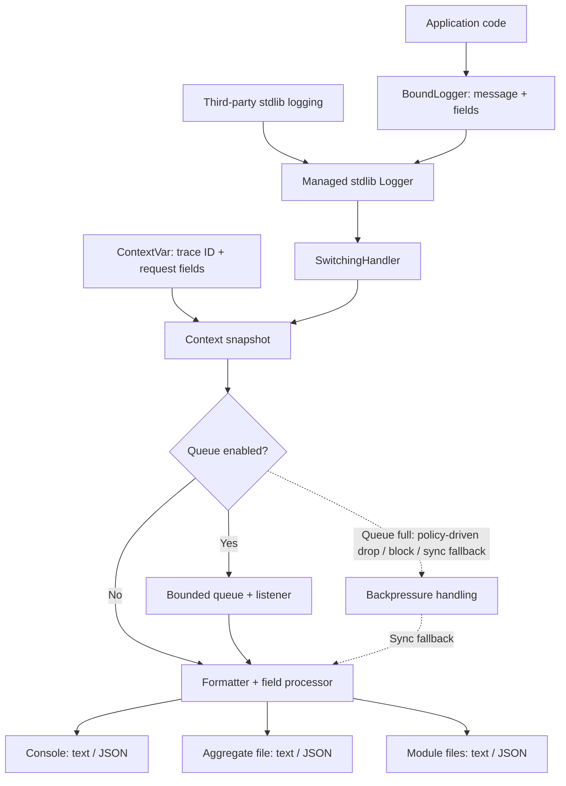

# cells-log

## 1. Introduction

**cells-log** is a lightweight, structured logging library for Python services, command-line applications, async workers, and data pipelines. It builds on Python's standard `logging` module while offering structured fields, request-scoped context, configurable text/JSON output, rotating files, and optional bounded queue delivery.

- **Python:** 3.10+; no mandatory runtime third-party dependencies.
- **Import:** `cells.log`.
- **Defaults:** JSON to stderr, synchronous delivery, no ANSI color, no log files, and no takeover of the root logger.
- **Ownership:** application code emits events; cells-log manages formatting and delivery. Existing third-party loggers can be captured explicitly.

The library favors predictable behavior: configuration can be replaced, queued records can be drained, and field-processing failures do not fall back to exposing unprocessed fields.

## 2. DFD — Data Flow Diagram



The context snapshot is taken on the producing thread before queue submission. The field processor and renderer run when a sink formats a record; the processor runs at most once **per record**, including when multiple sinks are enabled. A queue provides asynchronous **in-process** delivery, not durable storage. Sink failures and queue loss are observable but cannot be retroactively recovered.

## 3. Quick start

Install from the repository:

```bash
python -m pip install -e .
```

Configure once during application startup, then obtain loggers by stable module name:

```python
from pathlib import Path

from cells.log import LogConfig, configure_logging, get_logger, log_context, shutdown_logging

configure_logging(
    LogConfig(
        app_name="checkout",
        level="INFO",
        format="json",
        format_for_console="text",
        format_for_file="json",
        log_dir=Path("./logs"),
        enable_total_file=True,
    ),
    strict=True,
)

try:
    log = get_logger("checkout.payment").bind(component="payments")
    with log_context(trace_id="trace-123", request_id="req-42"):
        log.info("payment.authorized", order_id="o-17", amount=199.0)
        try:
            raise RuntimeError("gateway unavailable")
        except RuntimeError:
            log.exception("payment.failed", order_id="o-17")
finally:
    shutdown_logging()
```

Console output uses readable text; `./logs/checkout.log` receives structured JSON lines. `format_for_console` and `format_for_file` inherit `format` when set to `None`. File output is opt-in and requires `log_dir`.

To opt into terminal colors for console text logs only:

```python
LogConfig(format_for_console="text", console_color="auto")  # Only when stdout/stderr is a TTY
LogConfig(format_for_console="text", console_color="always")  # Explicitly force ANSI through pipes
```

The default `console_color=False` avoids ANSI escapes in CI, files, JSON, and log collectors.

For existing framework loggers, opt into exact-name capture rather than automatically taking over the root logger:

```python
LogConfig(capture_loggers=("uvicorn.error", "sqlalchemy.engine"))
```

Captured logger handlers are temporarily replaced and restored on shutdown. Do not simultaneously capture a logger name owned by `get_logger()`.

## 4. Public API

| API | Purpose |
|---|---|
| `LogConfig(...)` | Configure sinks, formats, rotation, queueing, and optional integrations. |
| `configure_logging(config, force=True, strict=False)` | Activate or replace logging; use `strict=True` to reject invalid explicit configuration. |
| `bootstrap_logging(app_name="app", env_prefix="CELLS_LOG")` | Early startup console-only logging (files and queue disabled). |
| `config_from_env(...)` | Build a `LogConfig` without activating it. |
| `configure_logging_from_env(...)` | Build and activate environment-driven configuration. |
| `get_logger(name=None)` | Obtain a `BoundLogger`; use module names, not dynamic user/request IDs. |
| `log.bind(**fields)` | Return a new logger with persistent fields; does not mutate the original. |
| `log.trace/debug/info/success/warning/error/fail/critical(message, **fields)` | Emit a message with named structured fields. `success` = INFO; `fail` = ERROR. |
| `log.exception(message, **fields)` | Emit ERROR with the current exception traceback (normally inside `except`). |
| `log.is_enabled_for(level)` | Check whether a severity is enabled. |
| `log.timings(event, metrics=(), **fields)` | Collect stage durations and emit a single summary. |
| `log_context(trace_id=None, **fields)` | Scoped trace ID and fields, automatically restored on exit. |
| `set_trace_id` / `reset_trace_id` | Low-level trace-context token management. |
| `bind_log_context` / `reset_log_context` | Low-level field-context token management. |
| `get_trace_id()` / `get_log_context()` | Read current context. |
| `flush_logging(timeout=None)` | Drain accepted queued records and flush active sinks; returns `bool`. |
| `get_queue_stats()` | Read queue acceptance, drops, fallback, errors, and latency counters. |
| `shutdown_logging()` | Drain, close sinks, and restore managed external logger state. |

`BoundLogger` methods accept **`message, **fields`**, not the standard `logging` positional interpolation pattern (`log.info("x=%s", x)`). For standard logging integration, existing `logging.getLogger(...)` calls continue using stdlib conventions.

Other exported names include `TimingCollector`, `LogStage`, `TRACE_LEVEL_NUM`, `parse_log_level`, `FieldProcessor`, and `JsonDumps`; ordinary application code rarely needs to import them directly.

## 5. Environment variables

Use `configure_logging_from_env(env_prefix="CELLS_LOG")`. Replace `CELLS_LOG` with your chosen prefix if needed. Explicit `app_name` takes precedence over `base.app_name`; environment values override supported fields in the base configuration.

| Variable | Value / effect |
|---|---|
| `CELLS_LOG_LEVEL` | Severity: `TRACE`, `DEBUG`, `INFO`, `WARNING`, `ERROR`, `CRITICAL`. |
| `CELLS_LOG_FORMAT` | Default format: `json` or `text`. |
| `CELLS_LOG_FORMAT_FOR_CONSOLE` | Console override: `json` or `text`. |
| `CELLS_LOG_FORMAT_FOR_FILE` | File override: `json` or `text`. |
| `CELLS_LOG_DIR` | Directory for file sinks. |
| `CELLS_LOG_FILE` | Aggregate file name/path. |
| `CELLS_LOG_ENABLE_CONSOLE` | Enable or disable console sink. |
| `CELLS_LOG_CONSOLE_COLOR` | `false` (default), `true`/`auto` (TTY-only), or `always` (force ANSI in text console). |
| `CELLS_LOG_ENABLE_MODULE_FILE` | Enable per-module rotating files. |
| `CELLS_LOG_ENABLE_TOTAL_FILE` | Enable aggregate rotating file. |
| `CELLS_LOG_ROTATION` | `daily` or `size`. |
| `CELLS_LOG_RETENTION` | Number of rotated backups (integer). |
| `CELLS_LOG_SIZE_LIMIT` | Per-file limit, e.g. `100MB`. |
| `CELLS_LOG_USE_QUEUE` | Use bounded in-process queue (default: `false`). |
| `CELLS_LOG_QUEUE_CAPACITY` | Queue capacity (default: `10000`). |
| `CELLS_LOG_QUEUE_FULL_POLICY` | `drop`, `block`, or `sync_fallback`. |
| `CELLS_LOG_QUEUE_FALLBACK_MIN_LEVEL` | Optional priority threshold, e.g. `ERROR`. |
| `CELLS_LOG_CAPTURE_LOGGERS` | Comma-separated **exact** third-party logger names. |
| `CELLS_LOG_CAPTURE_WARNINGS` | Capture Python warnings. |
| `CELLS_LOG_MANAGE_ROOT_LOGGER` | Opt into root logger takeover. |

Color applies only to **console text** output, never JSON output or file logs. `LogConfig(console_color=False)` is the default; `True` is the same as `"auto"` and checks the selected output stream (`stdout` or `stderr`). Auto mode also respects `NO_COLOR` and `TERM=dumb`. `"always"` deliberately bypasses TTY and `NO_COLOR` checks: use it only when the terminal at the end of a Docker logging pipeline can render ANSI. `docker compose logs -f` by itself does not make the process's stdout/stderr a TTY. To change this in the service deployment, use e.g. `CELLS_LOG_FORMAT_FOR_CONSOLE=text` plus `CELLS_LOG_CONSOLE_COLOR=always`. Do not use forced color when feeding a log aggregator.

The setting controls **only the ANSI level prefix generated by cells-log**. Third-party message content and `LogRecord` extra fields are preserved as before, including any ANSI sequences or `color_message` provided by Uvicorn. This setting does not control colors generated by third-party loggers themselves.

Boolean values accept `1/true/yes/y/on` and `0/false/no/n/off` (case-insensitive). Invalid environment booleans and integers generate warnings and keep their fallback values. `strict=True` validates an explicit `LogConfig`; it does not turn the environment parser into a strict parser. Other options, including `field_processor`, `json_dumps`, `queue_block_timeout`, and `module_name_prefixes`, are configured in Python.

## 6. Flush barrier

```python
from cells.log import flush_logging, get_queue_stats

if not flush_logging(timeout=3.0):
    raise TimeoutError("Logging did not drain before the deadline")

stats = get_queue_stats()
print(stats["dropped_records"], stats["delivery_errors"])
```

`flush_logging()` holds a logging handover barrier, waits for previously accepted queue work to finish, and invokes `flush()` on console and all active file streams. It also works in synchronous mode.

- Returns `True` when the in-process barrier completes; `False` on lock-acquisition or queue-drain timeout.
- `timeout=None` waits without a deadline. A timeout **does not bound** an individual sink's own blocking `flush()`.
- A successful return **does not** mean `fsync`, crash-safe persistence, remote delivery, or recovery of previously dropped records.
- It is a blocking call: do not invoke it from the queue listener, a logging sink, or a latency-sensitive event loop.

Queue admission uses `drop` by default when full. With `block`, the producer waits up to `queue_block_timeout`; `sync_fallback` writes on the producer thread. `queue_fallback_min_level="ERROR"` can opt higher-severity events into synchronous fallback when full, at the cost of possible blocking and out-of-order delivery. `get_queue_stats()` reports accepted, dropped, fallback and dispatch outcomes; counters reset on reconfiguration and are **not** a durable-delivery acknowledgment.

## 7. Context propagation

`ContextVar` keeps request/task fields separate across asyncio tasks. Prefer a scope around a **request or job**, not around every log call:

```python
from cells.log import get_logger, log_context

log = get_logger(__name__)

async def process_request(request_id: str) -> None:
    with log_context(trace_id="trace-abc", request_id=request_id):
        log.info("request.started")
        await perform_work()
        log.info("request.completed")
```

Nested `log_context()` scopes override fields temporarily and restore them on exit, including when an exception is raised. A synchronous `with` works inside `async def`; no separate async context manager is necessary.

Field precedence is **context < standard-logging `extra` < logger `bind()` < call-site fields** (later values win). `trace_id` is a separate top-level attribute. For low-level integrations, use `set_trace_id()` / `reset_trace_id()` and `bind_log_context()` / `reset_log_context()` tokens in `try/finally`.

Asyncio task creation inherits a snapshot of the current context; ordinary new threads do **not** automatically inherit it. Explicitly propagate context when using thread pools or custom thread workers. A queued log record captures its context before leaving the producer thread, but nested mutable field objects are shallow-copied, not frozen.

## 8. Hook model

The kernel does not hard-code application-specific serialization or redaction. Configure two optional hooks on `LogConfig`:

| Hook | Contract | Use cases |
|---|---|---|
| `field_processor(fields)` | Receives a shallow copy of merged fields; returns a mapping. Invoked at most once per record across sinks. | Redaction, renaming, normalization, pruning. |
| `json_dumps(obj, **kwargs)` | Returns a JSON `str`; called with `ensure_ascii=False` and retried without that keyword on `TypeError`. | Application-specific encoding of custom data types. |

```python
import json
from cells.log import LogConfig, configure_logging


def redact(fields: dict) -> dict:
    fields = dict(fields)
    if "authorization" in fields:
        fields["authorization"] = "[REDACTED]"
    return fields


configure_logging(
    LogConfig(field_processor=redact, json_dumps=json.dumps),
    strict=True,
)
```

**Security guarantees and limits:** if `field_processor` raises or returns an invalid mapping, cells-log discards the original field dictionary and emits only a sanitized `_field_processor_error` type marker. This is **fail-closed for structured fields**, not a general secret scanner: free-form messages and exception text are not redacted by the field hook. Hooks run during formatting (on the listener thread in queue mode), so sensitive fields can exist in memory inside queued records before redaction. Avoid logging secrets in messages, exceptions, or mutable objects, and do not treat the queue as a security boundary.
